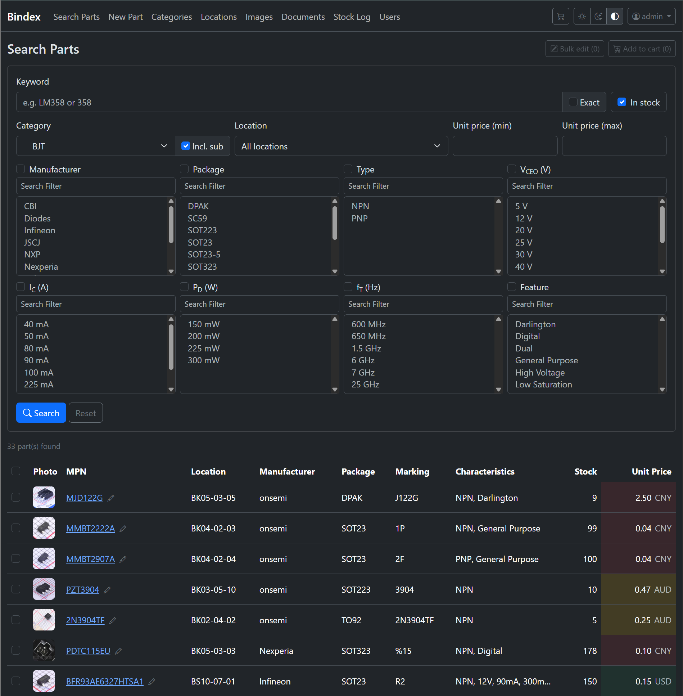

# Bindex

A self-hosted inventory system for electronic components — an index of what's
in your bins.

Built for a personal parts collection that outgrew a spreadsheet: a few hundred
part numbers spread across a few hundred labelled storage bins, where the
question is usually "do I have one, and which drawer is it in?"

Flask + SQLite. No build step, no JavaScript framework, no external services
required.



Above: every spec parameter a category defines becomes a filter, showing only
the values present in the current results — 33 transistors narrowed by package,
type, V<sub>CEO</sub>, I<sub>C</sub>, P<sub>D</sub> and f<sub>T</sub>.

---

## What it does

**Find a part.** Full-text search across MPN, marking, manufacturer and
description, with exact or substring matching. Narrow by category, storage
location, stock status or unit price.

**Parametric search.** Categories define their own spec parameters — a resistor
gets resistance/tolerance/power, a capacitor gets capacitance/voltage/dielectric
— and the parts list turns those into DigiKey-style faceted filters that show
only the values actually present in the current result set. Numeric values are
stored as numbers, so they sort and range-filter correctly, and render in
engineering notation (`750000` displays as `750k`).

**Track stock by batch.** Stock is held in lots, each with its own location,
quantity, purchase price and currency, so a part bought twice at different
prices stays honest about which is which. Stock in, stock out, return, move
between locations, and correct a miscount — every movement logged with the
operator, a running balance and a note.

**Pick lists.** Add parts to a cart while browsing, print the list sorted by
location, walk the shelf once, then confirm the whole lot in a single
stock-out.

**Categories and locations as trees.** Both are drag-to-reorder hierarchies with
right-click menus. Parametric attributes are inherited down the category tree,
and a child category can reorder, un-search or hide an inherited attribute
without affecting its siblings. The location tree shows how many batches sit
under each node and which parts are in each bin.

**Datasheets and photos.** Documents and photos can be shared across parts, so
one datasheet covers a whole family without duplication. PDFs preview in a side
pane sized to the document's own page shape, or in a floating window. Uploads
accept PDFs, Office and OpenDocument files, Markdown and plain text, images,
and archives.

**Photos from LCSC.** Look up a part number on LCSC and pull its product photos
in directly. Those photos put the component in a small corner of a large ruler
grid, so a heuristic suggests a tighter crop for the thumbnail and a Cropper.js
dialog lets you adjust it. Cropping only affects the thumbnail; the original is
kept.

**Per-user settings.** Light/dark/system theme, page sizes, which columns the
parts list shows, and the currency the price filter compares in — prices are
normalised through daily ECB exchange rates purely so a mixed-currency list can
be sorted.

---

## Running it

Python 3.11+ (developed on 3.14).

```bash
git clone https://github.com/gamalot/bindex.git
cd bindex
python3 -m venv .venv && .venv/bin/pip install -r requirements.txt

echo "SECRET_KEY=$(python3 -c 'import secrets; print(secrets.token_hex(32))')" > .env

.venv/bin/flask --app wsgi init-db        # tables + a starter category tree
.venv/bin/flask --app wsgi create-admin   # prompts for username and password
.venv/bin/flask --app wsgi run
```

Then open http://127.0.0.1:5000.

The database and all uploads live in `instance/` — that one directory is the
whole of your data.

### Other commands

| Command | What it does |
|---|---|
| `init-db` | Create tables and seed the category tree |
| `create-admin` | Create an admin account |
| `import-excel [path]` | Import a legacy spreadsheet ledger (`--dry-run` to preview) |
| `reclassify-parts` | Re-run category assignment over existing parts |
| `fetch-lcsc-photos` | Bulk-fetch product photos for parts that have none |
| `update-exchange-rates` | Refresh ECB rates (used only for price sorting) |

### Deploying

`deploy/` has a systemd unit, an nginx site and a nightly backup script. The
backup uses SQLite's own `.backup` API rather than copying the file, tars it
with the uploads, prunes after 14 days, and optionally pushes a copy offsite
with rclone.

Roughly:

```bash
rsync -az --delete --exclude='.venv' --exclude='instance' --exclude='.env' \
      ./ user@host:~/bindex/
```

Keep `instance/` and `.env` out of any deploy that uses `--delete`, or you will
delete your data and your secret key.

---

## Notes on the design

**SQLite on purpose.** One user, a few hundred parts, a home server. The whole
database is a file you can copy. Every page is a handful of queries.

**Attributes are EAV.** `attribute_defs` holds definitions per category,
`part_attribute_values` holds the values, and `category_attribute_order` holds
per-category overrides for inherited attributes. Values are stored as both text
and number so display and range queries can each use the right one.

**Server-rendered.** Jinja templates, Bootstrap 5, and vanilla JavaScript where
it earns its place — the tree widgets, the crop dialog, the LCSC picker. There
is no bundler and nothing to compile.

**Trees are loaded in bulk.** Walking a self-referential ORM relationship costs
a query per node; at ~750 locations that was ~2200 queries a page. `app/trees.py`
loads whole tables once and walks them in Python instead.

---

## Authorship

Every line of code and documentation in this repository was written by
[Claude Code](https://claude.com/claude-code), working from the author's
requirements, corrections and testing.

## Licence

MIT — see [LICENSE](LICENSE). Provided as is, with no warranty of any kind.

This is a personal project shared in case it's useful. It is not a product,
there is no support, and it may change or break at any time.
